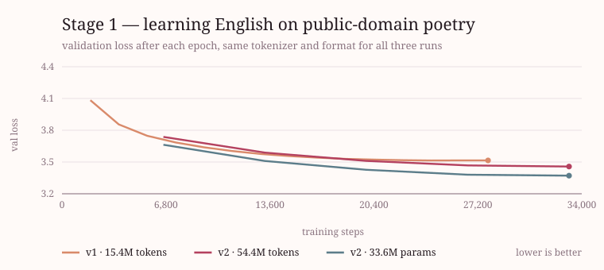
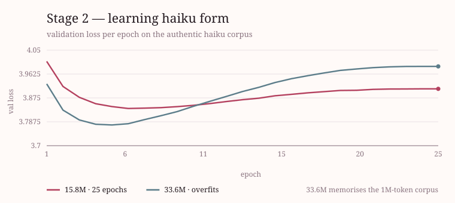
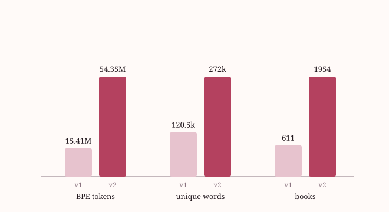
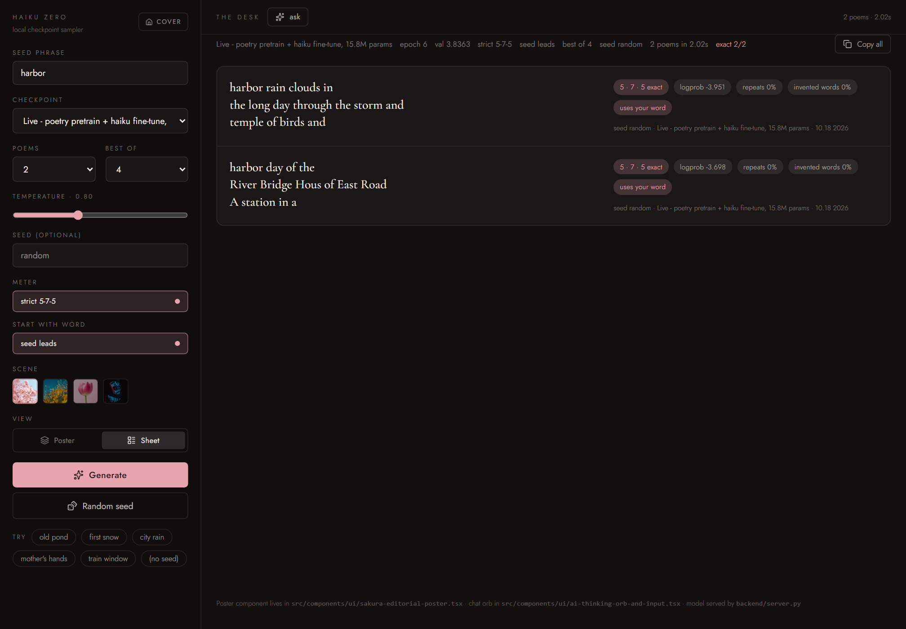

# HAIKU ZERO

A small language model that writes haiku, built from scratch in PyTorch and trained on one laptop.


You give it a word. It gives you three lines of 5-7-5 verse in about a second, on your own GPU, with no
API keys and no network. The whole stack is here: tokenizer, transformer, training loop, constrained
decoder, HTTP server and the interface in the screenshot above.

Two poems for the word `harbor`, as the app returns them:

```
harbor's day
and the silver moon beam
and the violet weeds

harbor muzzle in
always an hawk as a child
and the violet is
```

---

## The model

| | |
|---|---|
| Parameters | **15.79M**, tied input/output embeddings |
| Shape | 8 layers, 8 heads, 384 dim, FFN 1536, 64-token context |
| Tokenizer | byte-level BPE, 4,096 tokens, trained on the corpus |
| Precision | mixed fp16 with fp32 logits and a fp32 LM head |
| Hardware | RTX 4050 Laptop, 6 GB |
| Training | 65 minutes total, in two stages |

Two stages, because vocabulary and form are different problems.

**Stage 1 learns English.** 54.35M tokens of public-domain poetry from Project Gutenberg: 1,954 books,
1.35M three-line passages, 272k distinct words. A language model trained only on 40k haiku has never
seen most English words and invents the rest; this stage is what fixed that.

**Stage 2 learns haiku.** The same weights, fine-tuned for 25 epochs on 39,697 real haiku with the
5-7-5 form and a seed token in front. This is where the model stops writing long-lined verse and starts
closing lines.





The gap widened the corpus, not the model: rebuilding stage 1 from 15.4M to 54.4M tokens cut the number
of invented words in raw samples from 34% to 24%, and doubling the model to 33.6M parameters made every
sample *worse* while its validation loss improved. The second corpus is the useful one.



## What it actually promises

A 15.8M model cannot reliably count syllables, so the decoder does it while writing. Lines close on a
syllable target, candidates that would overshoot or introduce junk are masked out of the top-k, and four
samples are drawn per poem and reranked on fluency, real words, seed adherence and meter.

Measured on 150 strict poems from the live checkpoint:

| Promise | Measured |
|---|---|
| Three lines, exact 5-7-5 | **100%** |
| Repeats a content word | **0%** |
| Words the training text never contained | **0%** |
| Junk characters or `?` filler | **0%** |
| Says the seed word | **100%** |
| Latency, one poem (best-of 4, RTX 4050) | **0.9 s** |
| Latency, two poems over HTTP | **2.2 s** |

Raw sampling, with the decoder switched off, is honest about the model underneath: 24% of poems contain
an invented word and 25% repeat one. The decoder is not hiding a bug, it is doing the job the weights
cannot.

## The interface

Built with React, TypeScript and Tailwind. The model runs behind `backend/server.py`, a stdlib HTTP
server that also serves the built front end.

| Write | Desk |
|---|---|
|  |  |

<p align="center">
  
</p>

## Run it

Windows, Python 3.11, CUDA. Three batch files, no arguments needed:

| Double-click | What it does |
|---|---|
| `setup.bat` | Creates `pytorch_with_gpu`, installs PyTorch + CUDA, builds the front end |
| `run.bat` | Starts the server and opens `http://127.0.0.1:8000` |
| `train.bat` | Runs both training stages in order (`train.bat 3` for a 3-epoch stage 1) |

Everything below is the same thing spelled out by hand. The environment is `pytorch_with_gpu` (see
[RUNBOOK.md](RUNBOOK.md) §1 for the exact install).

```powershell
# 1. serve the model and the built front end
python -m backend.server          # http://127.0.0.1:8000

# or the CLI
python -m backend.generate --prompt autumn --strict --best-of 4

# 2. rebuild the data and the tokenizer from scratch (optional, ~4 min)
python fetch_poetry.py --out data/poetry_pretrain_v2.txt --max-chars 150e6 --max-books 3000
                                                # public-domain poetry -> data/poetry_pretrain_v2.txt
python -m backend.prepare_data --raw-dir data/raw --out data/haikus_clean.txt
python -m backend.train_tokenizer

# 3. train both stages (~65 min on a 4050)
python -m backend.train --corpus data/poetry_pretrain_v2.txt --epochs 5 `
    --ckpt-dir checkpoints_pretrain_v2 --embed-dim 384 --layers 8 --ffn-dim 1536
python -m backend.train --corpus data/haikus_classical.txt --epochs 25 --lr 1e-4 `
    --init-from checkpoints_pretrain_v2/best.pt --ckpt-dir checkpoints `
    --embed-dim 384 --layers 8 --ffn-dim 1536
```

The front end dev server is separate: `cd frontend && npm install && npm run dev` (port 5177, proxies
`/api` to 8000).

## How it is checked

Nothing in the table above is a claim; each row comes from a script in the repo.

```powershell
python test_smoke.py          # pipeline, decoder rules, HTTP API - CPU, under a minute
python quality_floor.py       # fails (exit 1) if a promise in the table regresses
python quality_probe.py       # fixed probes across every checkpoint
python inference_sweep.py     # temperature / penalty / best-of: quality against seconds
python quality_floor.py --self-test   # proves the gate can fail
```

## Layout

```
backend/
  config.py              hyperparameters in one place
  prepare_data.py        raw corpora -> haikus_clean.txt
  train_tokenizer.py     byte-level BPE, vocab 4096
  dataset.py             packing, splitting, loaders
  embedding.py           token + positional embeddings
  multi_head_attention.py hand-rolled causal attention
  transformer_block.py   pre-LN block
  model.py               the 15.8M model, tied head
  train.py               training loop, cosine LR, checkpoints
  meter_check.py         syllable counter and 5-7-5 check
  generate.py            sampling, constrained decoding, reranking
  server.py              HTTP API + static front end
frontend/                React desk UI (Vite, Tailwind v4)
fetch_poetry.py          Gutenberg catalogue -> stage-1 corpus
self_distill.py          distilled-pair experiments
make_charts.py           the charts above, from the training logs
docs/shoot.mjs           the screenshots above, from the running app
```

## Where the data comes from

All training text is public domain or openly licensed: Project Gutenberg poetry (1,954 books),
`statworx/haiku`, and several small haiku collections already vendored in `data/raw/`. Nothing is
scraped at training time and the model ships with no licence obligations beyond attribution.

## Known limits

- **Meaning is thin.** A 15.8M model over 1M haiku tokens writes plausible phrases, not ideas. More
  capacity did not help; more haiku would.
- **Free meter is bounded, not shaped.** Strict mode is the one that looks like a haiku.
- **The decoder carries the form.** Remove the reranker and the numbers in the table collapse.
- **The syllable counter is a heuristic**, roughly ±1 on unusual words, which is why the UI reports a
  distance rather than claiming a perfect haiku.

More detail, including every experiment that failed: [PROGRESS.md](PROGRESS.md) for the log,
[RUNBOOK.md](RUNBOOK.md) for commands and expectations, [SYNTH_CORPUS_REPORT.md](SYNTH_CORPUS_REPORT.md)
for the authored-data work.
