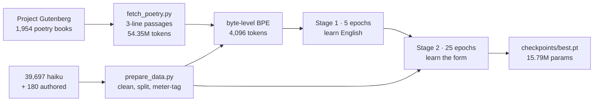
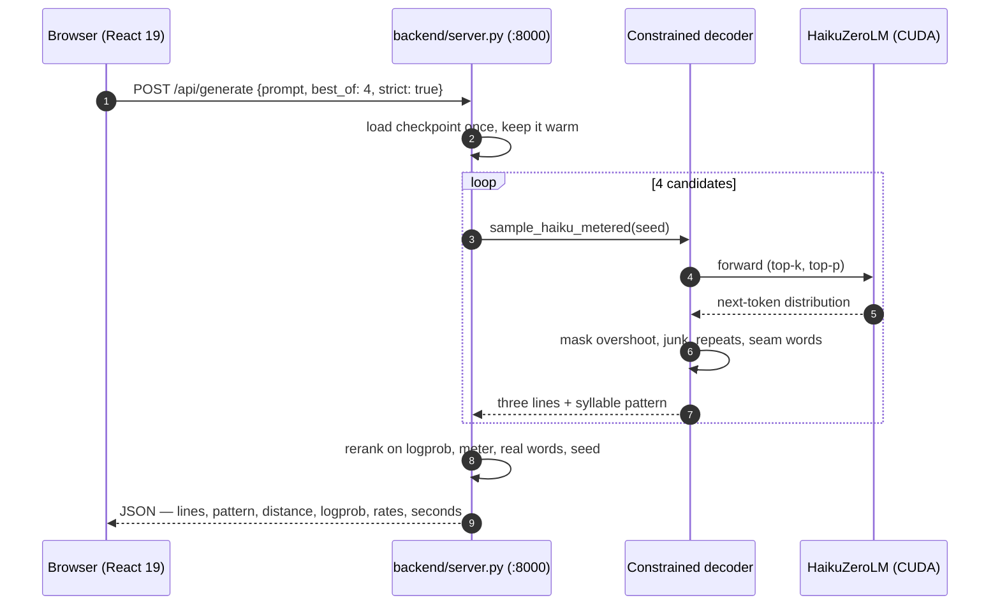
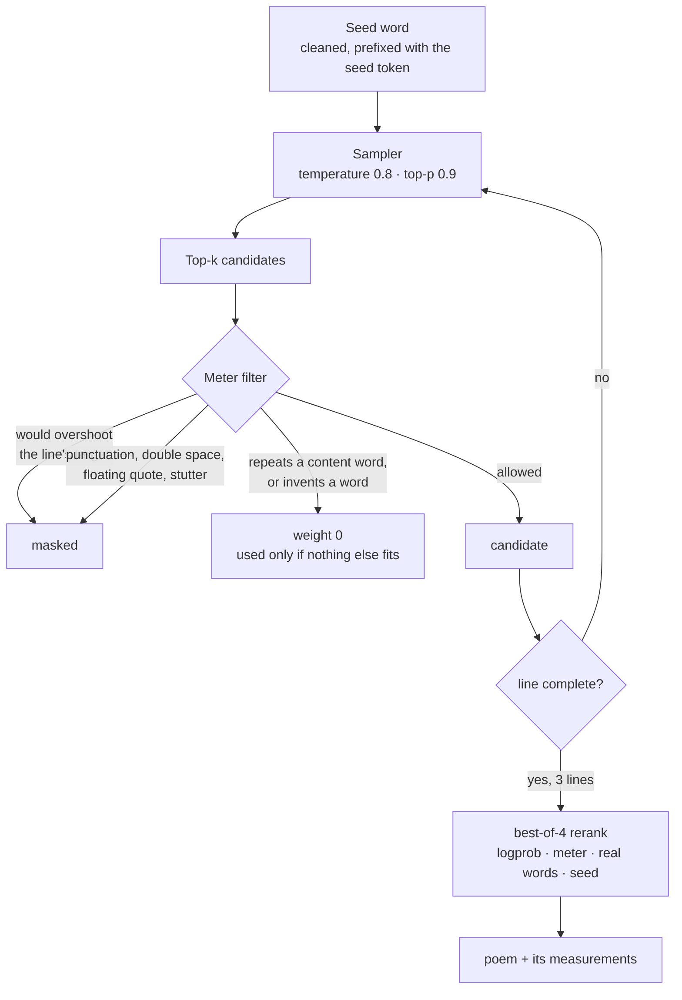

<h1 align="center">HAIKU ZERO</h1>

<p align="center">
  <b>A 15.8M-parameter language model that writes 5-7-5 haiku — built from scratch, trained on one laptop.</b><br/>
  <sub>Give it a word. A second later you have three measured lines, on your own GPU.</sub><br/>
  <sub><i>No API keys · no cloud · no pretrained weights · nothing leaves your machine.</i></sub>
</p>

<p align="center">
  
</p>

<p align="center">
  
  
  
  
  
  
  
  
  
</p>

<p align="center">
  <a href="#quick-start"><b>Quick start</b></a> &nbsp;·&nbsp;
  <a href="#screenshots">Screenshots</a> &nbsp;·&nbsp;
  <a href="#how-it-works">How it works</a> &nbsp;·&nbsp;
  <a href="#the-model">The model</a> &nbsp;·&nbsp;
  <a href="#the-promise-measured">Measured</a> &nbsp;·&nbsp;
  <a href="#api">API</a> &nbsp;·&nbsp;
  <a href="#troubleshooting">Troubleshooting</a>
</p>

---

## Why HAIKU ZERO

- **The form is guaranteed, not hoped for.** A constrained decoder masks every token that would overshoot a line's syllable target or drag punctuation in, so 5-7-5 closes while the model writes — no retry loop, no rejection sampling. 100% exact on 150 strict poems.
- **Every claim is a script.** The table below is not a promise in prose: `quality_floor.py` re-measures it and exits `1` when a floor is crossed. `--self-test` proves the gate can actually fail.
- **Two stages, because vocabulary and form are different problems.** 54.35M tokens of public-domain poetry teach English; 39,697 real haiku teach the shape. Training only on haiku leaves a model that invents the rest of the language.
- **One second, locally.** 0.9 s for a best-of-4 poem on an RTX 4050 Laptop; 2.2 s for two poems over HTTP, including the JSON round trip. No network call exists in the inference path.
- **It shows its work.** Every poem ships its syllable pattern, distance from 5-7-5, mean log-likelihood, repeated-word rate, unattested-word rate and whether it used the seed — the sheet view prints all of them next to the verse.
- **Two ways to read it.** A full-bleed poster with generated sakura scenes, or a plain desk sheet that reads like a notebook page. Same poem, same numbers.
- **Every knob is exposed.** Seed word, model, poem count, strict on/off, best-of 1-16, temperature, sampling seed — all in the panel, with the checkpoint folder auto-discovered.

---

## Quick start

Windows, Python 3.11, CUDA. Three batch files, no arguments:

| Double-click | What happens |
|--------------|--------------|
| `setup.bat` | Creates `pytorch_with_gpu`, installs PyTorch + CUDA, `npm install` and builds the front end |
| `train.bat` | Runs stage 1 then stage 2 in order (`train.bat 3` for a 3-epoch stage 1) |
| `run.bat` | Starts the server on `:8000`, waits for `/api/health`, opens your browser |

`run.bat` is also the doctor: if the environment is missing it runs `setup.bat` first, and if `checkpoints/best.pt` is absent it tells you to train instead of starting a server with no model.

> **A fresh clone has no model and no corpora.** `checkpoints/*.pt` (181 MB), `data/` and `tokenizer.json` are all ignored by git, so the first run rebuilds them — [RUNBOOK.md](RUNBOOK.md) §2 has the exact commands. `run.bat` refuses to start without `checkpoints/best.pt`, and `train.bat` exits naming whichever corpus file is missing. Dropping in a `best.pt` from elsewhere works too, but `tokenizer.json` has to come from the same corpus.

<details>
<summary><b>Manual flow</b> (the same thing by hand)</summary>

```powershell
# 1. serve the model and the built front end
python -m backend.server          # http://127.0.0.1:8000

# or the CLI
python -m backend.generate --prompt autumn --strict --best-of 4

# 2. rebuild the data and the tokenizer from scratch (optional, ~4 min)
python fetch_poetry.py --out data/poetry_pretrain_v2.txt --max-chars 150e6 --max-books 3000
python -m backend.prepare_data --raw-dir data/raw --out data/haikus_clean.txt
python -m backend.train_tokenizer

# 3. train both stages (~65 min on a 4050)
python -m backend.train --corpus data/poetry_pretrain_v2.txt --epochs 5 `
    --ckpt-dir checkpoints_pretrain_v2 --embed-dim 384 --layers 8 --ffn-dim 1536
python -m backend.train --corpus data/haikus_classical.txt --epochs 25 --lr 1e-4 `
    --init-from checkpoints_pretrain_v2/best.pt --ckpt-dir checkpoints `
    --embed-dim 384 --layers 8 --ffn-dim 1536
```
</details>

<details>
<summary><b>Front-end dev server</b> (hot reload, instead of the built files)</summary>

```powershell
cd frontend
npm install
npm run dev          # port 5177, proxies /api to :8000
```

Run `python -m backend.server` in a second window. Without a built `frontend/dist`, `:8000` answers the API and returns a 503 with this exact hint for everything else.
</details>

---

## Screenshots

<p align="center">
  
  <br/>
  <em>Write stage — a single poem rendered as a poster, with the seed word as the title.</em>
</p>

<p align="center">
  
  <br/>
  <em>Desk sheet — two poems, each with its syllable pattern, distance, logprob and word checks.</em>
</p>

<p align="center">
  
  <br/>
  <em>The same page at 390 px — the poster stacks, the sheet scrolls.</em>
</p>

---

## How it works

The stack is the model and nothing else: a byte-level BPE tokenizer, a hand-written pre-LN transformer, a training loop, a decoder that enforces the form, a stdlib HTTP server and a React front end. `torch` is the only dependency the model itself needs.

### 1 · Build a model (once)



### 2 · Ask for a poem



### 3 · The part that makes the verse hold



At 15.8M parameters the weights cannot count syllables. The decoder can, so it does — and the reranker picks the most fluent of four attempts that already satisfy the form. Switch strict off and you see the model underneath: 24% of raw poems contain an invented word and 25% repeat one.

---

## The model

| Spec | Value |
|---|---|
| Parameters | **15.79M**, tied input/output embeddings |
| Shape | 8 layers · 8 heads · 384 dim · FFN 1536 · 64-token context |
| Tokenizer | byte-level BPE, 4,096 tokens, trained on this corpus |
| Precision | mixed fp16, fp32 logits and fp32 LM head; AMP off on CPU |
| Hardware | RTX 4050 Laptop, 6 GB |
| Training | 65 minutes total, two stages |
| Decoding | temperature 0.8 · top-p 0.9 · repetition penalty 1.3 · best-of 4 |

**Stage 1 learns English.** 54.35M tokens of public-domain poetry: 1,954 books, 1.35M three-line passages, 272k distinct words, five epochs. A model trained only on 40k haiku has never seen most English words and invents the rest; this stage is what fixed that.

**Stage 2 learns haiku.** The same weights, fine-tuned for 25 epochs on 39,697 real haiku with the 5-7-5 form and a seed token in front. This is where the model stops writing long-lined verse and starts closing lines.

<p align="center">
  
  
</p>

<p align="center">
  
</p>

The gap widened the corpus, not the model: rebuilding stage 1 from 15.4M to 54.4M tokens cut invented words in raw samples from **34% to 24%**, and doubling the model to 33.6M parameters made every sample *worse* while its validation loss improved (stage-2 val 3.8363 → 3.7759). The second corpus is the useful one; the parameter budget is not the binding constraint.

---

## The promise, measured

Measured on 150 strict poems from the live checkpoint:

| Promise | Measured |
|---|---|
| Three lines, exact 5-7-5 | **100%** |
| Repeats a content word | **0%** |
| Words the training text never contained | **0%** |
| Junk characters or `?` filler | **0%** |
| Says the seed word | **100%** |
| Latency, one poem (best-of 4, RTX 4050) | **0.9 s** |
| Latency, two poems over HTTP | **2.2 s** |

The baseline the gate measures against lives in [logs/quality_floor.json](logs/quality_floor.json) and is checked in on purpose — it is what a regression is defined against:

| Metric | Floor | Direction |
|---|---|---|
| `exact` | 0.98 | at least |
| `seed` | 0.95 | at least |
| `repeat` | 0.06 | at most |
| `nonword` | 0.04 | at most |
| `junk` | 0.02 | at most |

```powershell
python quality_floor.py                # exit 1 if any floor is crossed
python quality_floor.py --self-test    # proves the gate can fail
python test_smoke.py                   # pipeline, decoder rules, HTTP API — CPU, under a minute
python quality_probe.py                # fixed probes across every checkpoint
python inference_sweep.py              # temperature / penalty / best-of: quality against seconds
```

---

## Data

| Corpus | What it is | Size | Used by |
|---|---|---|---|
| Project Gutenberg poetry | public-domain verse, 1,954 contributing books | **54.35M tokens** | stage 1 |
| `statworx/haiku` + vendored collections | real haiku, already cleaned and deduplicated | **39,697 poems** (≈0.99M tokens) | stage 2 |
| `data/raw_synthetic/` | 180 hand-written haiku, all exact 5-7-5 by `meter_check` | 180 poems | fine-tune experiments |

Nothing is scraped at training time, there is no pretrained checkpoint, and the corpora are rebuildable from the scripts — they are not in git.

> **The limit is the corpus.** 0.99M stage-2 tokens for a 15.8M model: more parameters overfit it (measured), more epochs flatten (measured), more haiku is the lever that is actually left.

---

## API

`backend/server.py` is a stdlib `ThreadingHTTPServer` — no FastAPI, no framework, no extra dependency. It serves the API and the built front end from the same port.

| Endpoint | Method | Purpose |
|---|---|---|
| `/api/health` | `GET` | `{ ok, device, torch, loaded, frontend_built }` |
| `/api/models` | `GET` | every `checkpoints*/best.pt` found, plus the default |
| `/api/generate` | `POST` | the poem: candidates, rerank, measurements |
| `/` | `GET` | `frontend/dist` with SPA fallback |

<details>
<summary><b>Request and response bodies</b></summary>

```jsonc
// POST /api/generate
{
  "prompt": "harbor",        // seed word or short phrase, cleaned to letters
  "model": "",               // default checkpoint when omitted
  "count": 1,                // 1-6 poems
  "strict": true,            // meter-constrained decoding
  "best_of": 4,              // 1-16 candidates per poem
  "seed_first": true,        // put the seed word in line one
  "temperature": 0.8,
  "top_p": 0.9,
  "repetition_penalty": 1.3,
  "seed": null               // sampling seed for reproducibility
}
```

```jsonc
// 200
{
  "model": "checkpoints",
  "model_label": "Live - poetry pretrain + haiku fine-tune, 15.8M params",
  "epoch": 6, "val_loss": 3.8363,
  "prompt": "harbor", "strict": true, "best_of": 4, "seed": 1234,
  "poems": [{
    "lines": ["harbor's day", "and the silver moon beam", "and the violet weeds"],
    "pattern": [5, 7, 5],
    "distance": 0, "exact": true, "strict_ok": true,
    "logprob": -2.31, "repeated_rate": 0.0,
    "unattested_rate": 0.0, "seed_hit": true
  }],
  "seconds": 0.93, "load_seconds": 1.8
}
```
</details>

---

## Tech stack

| Layer | Tech |
|-------|------|
| Model | PyTorch 2.14 + CUDA 13 · hand-written embeddings, causal attention, pre-LN block, tied LM head |
| Tokenizer | `tokenizers` byte-level BPE, 4,096 vocab, trained in-repo |
| Training | own loop — AdamW, warmup + cosine, grad clip, AMP, checkpoint/ resume, CSV + preview logging |
| Decoding | constrained metered sampling, candidate masking, best-of-n reranking, heuristic syllable counter |
| API | Python stdlib `ThreadingHTTPServer` · JSON, `no-store`, model cache with a lock |
| Front end | React 19 · TypeScript 6 · Vite 8 · Tailwind v4 · lucide-react |
| Data | Gutenberg catalogue fetch, `pyarrow` for the HF parquet intake, `numpy` for corpus stats |

---

## Layout

```
backend/
  config.py              every hyperparameter in one place
  prepare_data.py        raw corpora -> haikus_clean.txt
  train_tokenizer.py     byte-level BPE, vocab 4096
  dataset.py             packing, splitting, loaders
  embedding.py           token + positional embeddings
  multi_head_attention.py  hand-rolled causal attention
  transformer_block.py   pre-LN block
  model.py               the 15.8M model, tied head
  train.py               training loop, cosine LR, checkpoints
  meter_check.py         syllable counter and 5-7-5 check
  generate.py            sampling, constrained decoding, reranking
  server.py              HTTP API + static front end
frontend/                React desk UI (Vite, Tailwind v4)
  src/App.tsx            stages, poster/sheet switch, result state
  src/components/haiku-console.tsx        the settings panel
  src/components/ui/     sakura-editorial-poster.tsx — the poster renderer
  src/lib/api.ts         typed client for the three routes
  src/lib/sakura-scenes.ts               generated poster backdrops
fetch_poetry.py          Gutenberg catalogue -> stage-1 corpus
self_distill.py          distilled-pair experiments
make_charts.py           the three SVGs above, from the CSVs
docs/shoot.mjs           the screenshots above, from the running app
data/                    corpora + word lists (regenerated, not in git)
checkpoints/             the live weights (not in git)
logs/quality_floor.json  the regression baseline (checked in on purpose)
RUNBOOK.md               every command and what it should print
PROGRESS.md              the log, including the experiments that failed
```

---

## Troubleshooting

| Symptom | Fix |
|---------|-----|
| `[X] No model at checkpoints\best.pt` | `train.bat` once, or drop a trained `best.pt` into `checkpoints/` |
| "No environment yet" on first run | `run.bat` calls `setup.bat`; if that fails, the window keeps the pip error |
| `{"error": "front end not built"}` | `cd frontend && npm run build`, or run `npm run dev` and use `:5177` |
| Port 8000 already taken | `run.bat` detects the listener and just opens the browser; or `python -m backend.server --port 8001` |
| Health says `"device": "cpu"` | The CUDA build is missing — rerun `setup.bat`; CPU still works, just much slower |
| The first request is slow | The server preloads the default model on boot — give it a few seconds. `--no-warm` skips the preload and pays it on the first request instead |
| CUDA out of memory while training | `--batch-size 64` (the flag's help text says the same) |
| `quality_floor.py` exits 1 | The printed metric crossed its floor — compare against `logs/quality_floor.json` before changing anything |
| `ModuleNotFoundError: torch` | You used your global Python. The launchers use `pytorch_with_gpu\Scripts\python.exe`; run `setup.bat` if that folder is missing |
| UI looks unstyled | Hard refresh (`Ctrl+Shift+R`) — the built assets are cached by path |

---

## Known limits

- **Meaning is thin.** A 15.8M model over 1M haiku tokens writes plausible phrases, not ideas. More capacity did not help; more haiku would.
- **Free meter is bounded, not shaped.** Strict mode is the one that looks like a haiku.
- **The decoder carries the form.** Remove the reranker and the numbers in the table collapse.
- **The syllable counter is a heuristic**, roughly ±1 on unusual words, which is why the UI reports a distance rather than claiming a perfect haiku.
- **No GPU, no speed.** The model runs on CPU as well, but a poem takes seconds rather than a fraction of one.

More detail, including every experiment that failed: [PROGRESS.md](PROGRESS.md) for the log, [RUNBOOK.md](RUNBOOK.md) for commands and expectations, [SYNTH_CORPUS_REPORT.md](SYNTH_CORPUS_REPORT.md) for the authored-data work.

---

## Roadmap

- [x] Tokenizer, transformer, training loop, constrained decoder, HTTP API, desk UI
- [x] Two-stage training — poetry pretrain, then haiku fine-tune
- [x] Best-of-n reranking with meter, word and seed checks (strict exact 8/10 → 10/10)
- [x] Stage-1 corpus rebuilt to 54.35M tokens (invented words 34% → 24%)
- [x] Quality gate with a checked-in baseline and a working self-test
- [ ] **More authentic haiku** — the one lever that raises style without costing meter
- [ ] More authored 5-7-5 poems (180 → 400), then the same fine-tune command again
- [ ] Meter signal inside the weights — experimented with, lost to the decoder, not promoted
- [ ] Full temperature / penalty / best-of sweep surfaced in the UI instead of the CLI

The data side has its own plan, with measured throughput and the three routes a bigger corpus could take: [docs/DATA_PLAN.md](docs/DATA_PLAN.md).

---

## License & author

**MIT** — see [LICENSE](LICENSE). The licence covers the code, the charts and the screenshots; the trained weights and the corpora are not in this repository.

Built by **Kumar Harsh** · [@kumarharshzzz04](https://github.com/kumarharshzzz04)

Model code, tokenizer training, the training loop, the decoder, the server and the interface are all in this repository; inference needs nothing but PyTorch and the `tokenizers` library.

<sub>HAIKU ZERO — 15.8M parameters · 5-7-5 by construction · zero cloud</sub>
